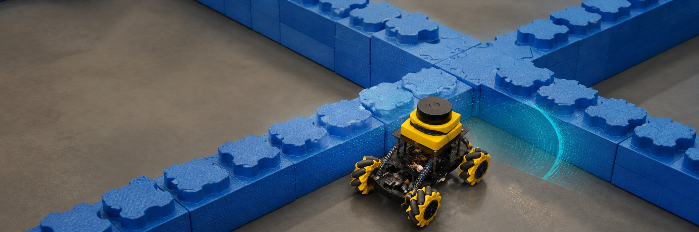
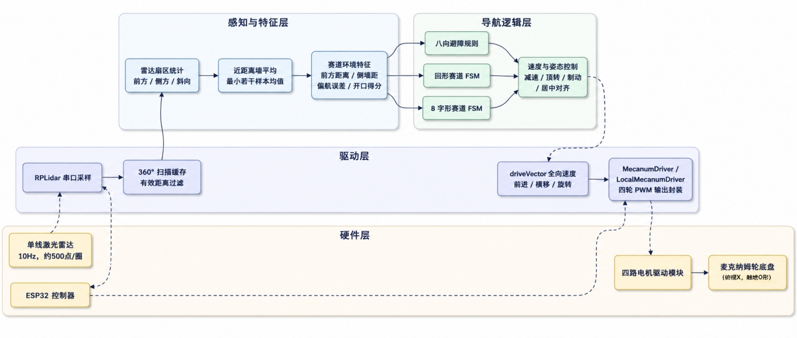
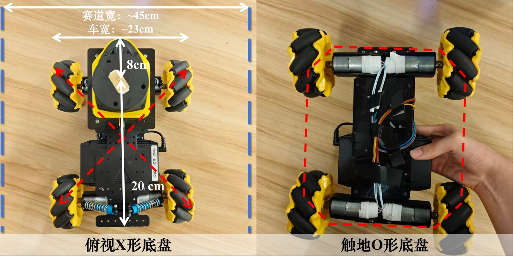
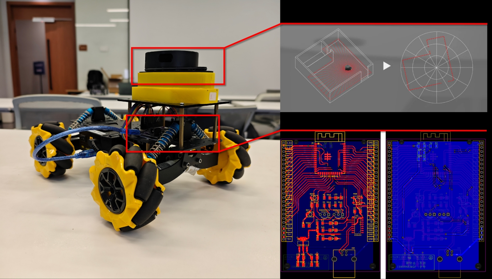
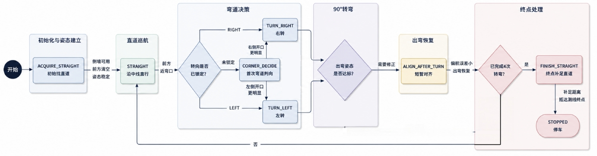
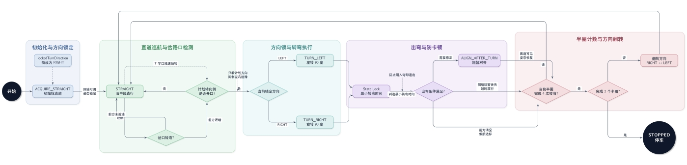
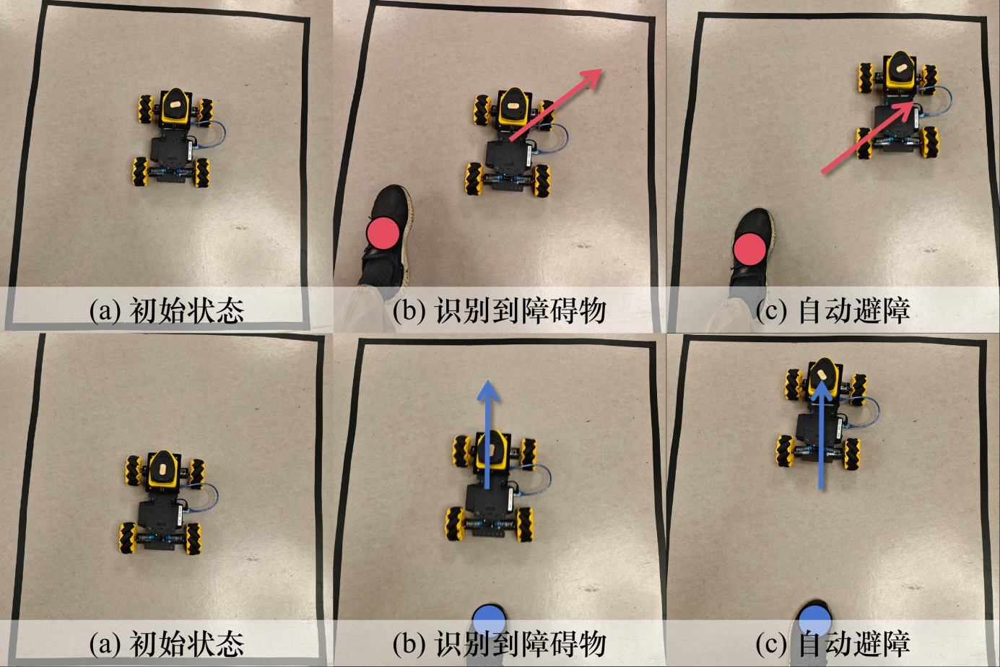
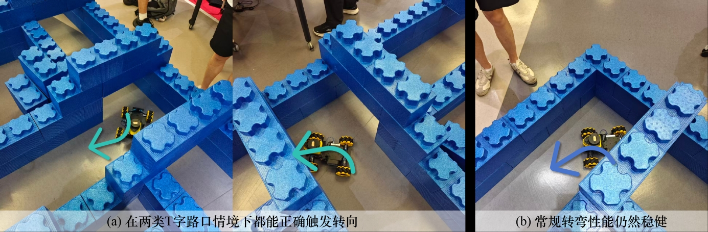

<p align="center">
  
</p>

<h1 align="center">EE1503 LiDAR Mecanum Robot</h1>

<p align="center">
  A practical finite-state-machine controller for obstacle avoidance, rectangular laps, and a figure-eight foam track.
</p>

<p align="center">
  <a href="#what-is-in-this-repository">Programs</a> ·
  <a href="#how-it-works">Design</a> ·
  <a href="#bring-up">Bring-up</a> ·
  <a href="#tuning-is-part-of-the-job">Tuning</a> ·
  <a href="#chinese-prompt-examples">Prompts</a>
</p>

## Overview

This repository grew out of the 2026 EE1503 *Engineering Practice and Technological Innovation I* LiDAR experiment. The platform is a four-wheel Mecanum robot controlled by an ESP32 and a single-line RPLidar. It turns raw scans into a small set of useful facts—how far the front wall is, where the side walls are, whether the body is yawed, and whether a junction has opened—then lets a finite-state machine decide what the car should do next.

The main goal is deliberately simple to describe and difficult to make reliable: follow the middle of a narrow blue-foam track, take the correct corners without touching a wall, complete exactly one lap, and stop. After that, the car can be picked up by hand, turned around, power-cycled, and sent around the course in the opposite global direction without changing the program.

Figures reproduced below were extracted from the course report and retain their original Chinese labels.

## What is in this repository

| Program | Purpose | Stop condition | Notes |
| --- | --- | --- | --- |
| [`rectangle_state_machine`](./rectangle_state_machine/rectangle_state_machine.ino) | One lap of a closed rectangular track | Four same-direction quarter-turns, followed by the estimated remaining straight | The first corner determines and locks the lap direction |
| [`8_state_machine`](./8_state_machine/8_state_machine.ino) | One complete figure-eight lap | Four right turns, direction flip, then four left turns | Uses a planned route and special T-junction detection |
| [`obstacle_avoidance`](./obstacle_avoidance/obstacle_avoidance.ino) | Eight-direction reactive avoidance | Stops when nothing is inside the safety radius | A compact starting point for checking LiDAR and wheel motion |

## System at a glance

<p align="center">
  
</p>

The software is split into four practical layers:

1. The RPLidar delivers a roughly 10 Hz scan with about 500 samples per revolution.
2. Samples are filtered and placed into 360 angular bins. Robust sector statistics summarize the front, sides, and diagonals.
3. Those features drive centering, yaw correction, corner or junction detection, and state transitions.
4. `driveVector(forward, strafeRight, rotateRight)` mixes the requested motion into four wheel commands.

The control loop does not rely on one perfect LiDAR point. Important events are checked across sectors and confirmed over multiple scans, which makes foam-edge reflections and occasional sparse data less disruptive.

## Hardware assumptions

The report prototype used an ESP32, a single-line RPLidar, four independently driven Mecanum wheels, and a track about `0.45 m` wide. The car was about `0.23 m` wide. Its LiDAR was mounted off-center: approximately `0.08 m` behind the front bumper and `0.20 m` ahead of the rear bumper.

The track programs use this angular convention:

| LiDAR angle | Robot direction |
| ---: | --- |
| `180°` | Front |
| `0°` | Rear |
| `90°` | Left |
| `270°` | Right |

The code constructs the motor driver with `LocalMecanumDriver(9, 8, 12, 13, 11, 10, 46, 21)` and starts the LiDAR on `Serial2`. The obstacle-avoidance sketch documents `Serial2` on pins 19 and 20. Check all of these assignments against the board and wiring actually in front of you before applying power.

<table>
  <tr>
    <td width="50%"></td>
    <td width="50%"></td>
  </tr>
  <tr>
    <td align="center"><sub>Measured chassis and LiDAR offset</sub></td>
    <td align="center"><sub>The report prototype</sub></td>
  </tr>
</table>

### Motor sign convention

Do not trust a wheel-layout name by itself. Wheel mounting, motor wiring, gearbox orientation, and driver polarity can all change the signs. For the convention used by the track controllers, this must be true when the car is safely lifted from the floor:

```cpp
mecanum.driveAllMotor(100, 100, 100, 100);  // the car must move forward
```

The local driver compensates for the prototype's motor polarity internally. If the four positive commands do not produce physical forward motion on your car, correct the motor mapping or direction multipliers before tuning any state-machine threshold.

With wheel order `LF, RF, LR, RR`, the expected logical commands are:

| Motion | LF | RF | LR | RR | `driveAllMotor(...)` |
| --- | :---: | :---: | :---: | :---: | --- |
| Forward | + | + | + | + | `(100, 100, 100, 100)` |
| Reverse | − | − | − | − | `(-100, -100, -100, -100)` |
| Strafe left | − | + | + | − | `(-100, 100, 100, -100)` |
| Strafe right | + | − | − | + | `(100, -100, -100, 100)` |
| Rotate left | − | + | − | + | `(-100, 100, -100, 100)` |
| Rotate right | + | − | + | − | `(100, -100, 100, -100)` |

The mixed controller uses:

```text
LF = forward + strafeRight + rotateRight
RF = forward - strafeRight - rotateRight
LR = forward - strafeRight + rotateRight
RR = forward + strafeRight - rotateRight
```

## How it works

### Rectangular track

The rectangular controller starts by acquiring a straight corridor and aligning with it. While driving, a lateral P correction keeps the LiDAR near the two-wall centerline, and a yaw P correction keeps the body parallel to the walls. Near a corner it slows down, confirms the trigger, decides whether the opening is on the left or right, and locks that direction for the rest of the lap.

Turns are closed-loop rather than purely timed. The controller moves through fast, slow, fine, and braking rotation stages, adds a small forward component to follow an arc, watches inside clearance, and leaves the turn only after the front opens and a usable side-wall geometry returns. After four turns it estimates the remaining part of the starting straight and enters `STOPPED`.

<p align="center">
  
</p>

### Figure-eight track

A figure-eight adds T-junctions and a wide crossbar. At those locations, “turn when the front wall is close” is not enough: the wall may be sparse or partly hidden, both sides can look open, and the side-wall signal may disappear for a moment.

The figure-eight program therefore follows a known route. It begins with four right turns, flips its locked direction, completes four left turns, and stops. A junction can be triggered either by a close front sector or by the planned turn-side opening while other sectors still show that the car remains inside the track. Timeouts and softer exit rules keep a brief loss of wall data from trapping the car in a turn forever.

<p align="center">
  
</p>

### Reactive obstacle avoidance

The smallest program finds the closest valid LiDAR return, divides the scan into eight 45-degree sectors, and commands motion away from the occupied sector. It is useful as a first hardware test, but the track controllers are the main work in this repository: they use richer sector features, state, debouncing, geometry, and fail-safe timing.

<p align="center">
  
</p>

## Bring-up

1. Install an ESP32 board package and an Arduino-compatible `RPLidar` library.
2. Open the `.ino` file from exactly one program directory. Keep its local driver `.h` and `.cpp` files beside it.
3. Match the motor pins, motor order, direction multipliers, `Serial2` pins, and LiDAR angle convention to your hardware.
4. Lift the car so all four wheels can spin freely. Test forward, reverse, both strafes, and both rotations at a low command first.
5. Confirm that a hand or board placed at the physical front appears near the angle expected by the selected sketch.
6. Start with conservative speed values, place the car near the middle of a straight, and open the serial monitor at `115200` baud.
7. Only after the direction and sensor checks pass should the car be tested inside the foam walls.

For a reverse-direction run, wait until the controller has stopped, pick the car up, turn it around, switch it off and on again, and start from the corresponding straight. Do not rotate or drag the car while its wheels are being driven.

## Tuning is part of the job

> [!IMPORTANT]
> This repository contains a tested strategy, not a universal calibration file. Two cars that look identical can still need different thresholds and PWM values.

Motor strength, battery voltage, wheel wear, roller direction, floor friction, chassis mass, LiDAR position, foam-wall reflectivity, and the exact way the track was assembled all matter. Re-measure `TRACK_WIDTH_M`, `CAR_WIDTH_M`, and `LIDAR_TO_FRONT_BUMPER_M`; do not inherit those values blindly from the report.

The figure-eight is especially dependent on on-site tuning. A state machine that completed the course yesterday can miss one T-junction on a different car or a newly rebuilt track and appear to be stuck at the same point. That does not automatically mean the route logic is wrong. Often the expected feature simply never crosses a threshold, or one exit condition never receives enough valid scans. Read the serial output before rewriting the state machine.

A useful tuning order is:

1. Verify wheel signs, LiDAR angles, motor order, and measured geometry.
2. Check scan quality and sector availability while the car is stationary.
3. Tune center and yaw correction at low straight-line speed.
4. Increase the slow-down distance before raising top speed.
5. Tune corner trigger distance, then turn stages and braking.
6. Tune T-junction opening predicates on the real figure-eight track.
7. Adjust confirmation counts and timeouts last; they trade responsiveness against false triggers.

| Symptom | Inspect first |
| --- | --- |
| The car snakes down a straight | `SIDE_TARGET_M`, `STRAFE_KP`, `YAW_KP`, correction limits |
| It reaches the front wall too fast | `FRONT_SLOW_M`, `FRONT_TURN_TRIGGER_M`, slow PWM |
| A turn overshoots | Fine/brake PWM, brake yaw window, scan confirmation delay |
| It clips the inside wall | LiDAR offset, turn arc forward PWM, inside-clearance strafe |
| It drives through a T-junction | `plannedTurnSideOpen()`, diagonal/open thresholds, minimum straight time |
| It remains in a turn or alignment state | Side-wall validity, yaw exit window, sensor/soft timeouts |
| It stops too early or too late on the rectangle | Captured leg progress, finish target estimate, speed-dependent PWM integration |

The serial output is designed for this job. Watch `STATE`, `turn`, `F/FW`, `L/R`, `LF/RF`, `CE`, `YE`, and `cmd` on the rectangle. The figure-eight adds `half`, `n`, `T`, and `TO`; together they tell you whether the program saw a front trigger, a turn-side opening, or neither.

## Results from the report

The report records five rectangular-track trials in each direction:

| Direction | Mean ± standard deviation |
| --- | ---: |
| Clockwise (`N = 5`) | `21.72 ± 0.48 s` |
| Counter-clockwise (`N = 5`) | `21.88 ± 0.56 s` |

These numbers describe one tuned prototype on one course; they are a result, not a default performance promise. **In fact, after further tuning, we achieved a lap time of approximately 19.1 s before the acceptance test.** We believe that, under the output power constraint, the theoretical best time on the rectangular track could be around 18 s.


The figure-eight controller also passed the course acceptance test, including both observed T-junction geometries.

<p align="center">
  
</p>

## Chinese prompt examples

The examples below are intentionally in Chinese so they can be pasted into the same working context as the original task. Give the model the relevant `.ino`, local driver files, serial logs, and track measurements whenever possible.

<details>
<summary><strong>Prompt 1 — implement or review the complete state machine</strong></summary>

```text
我接下来需要完成一个任务：让小车在蓝色泡沫赛道中运行，赛道俯视为矩形，要求不走重复的路。

小车顺时针完成一圈后，需要在程序不变的情况下自动停止。之后我们会人为、手动拿起车子，调转方向，关机重启，再让它逆时针完成一圈。请实现一个可靠、可调试的有限状态机。建议采用“直行 + 拐弯”的方案，因为雷达没有安装在车体几何中心；车头始终朝前。直行时走两侧墙的中线，识别到弯道后完成合适的 90° 转弯，并尽量避免碰撞，因为碰撞会产生罚时。

我的小车采用标准的麦克纳姆轮“俯视 O 型、触地 X 型”排布。请注意，不同小车的电机接线和驱动极性可能不同，下面这条实测基准比排布名称更重要：

mecanum.driveAllMotor(100, 100, 100, 100);

四个电机全部给正值时，小车向前行驶。轮子顺序为左前、右前、左后、右后，逻辑运动表如下：

| 运动状态 | 左前 Index 0 | 右前 Index 1 | 左后 Index 2 | 右后 Index 3 | driveAllMotor(...) |
| --- | ---: | ---: | ---: | ---: | --- |
| 前进 | + | + | + | + | (100, 100, 100, 100) |
| 后退 | - | - | - | - | (-100, -100, -100, -100) |
| 左平移 | - | + | + | - | (-100, 100, 100, -100) |
| 右平移 | + | - | - | + | (100, -100, -100, 100) |
| 左前斜行 | 0 | + | + | 0 | (0, 100, 100, 0) |
| 右前斜行 | + | 0 | 0 | + | (100, 0, 0, 100) |
| 左后斜行 | - | 0 | 0 | - | (-100, 0, 0, -100) |
| 右后斜行 | 0 | - | - | 0 | (0, -100, -100, 0) |
| 原地左转（逆时针） | - | + | - | + | (-100, 100, -100, 100) |
| 原地右转（顺时针） | + | - | + | - | (100, -100, 100, -100) |

核心任务：

1. 先阅读现有 .ino、驱动文件和状态机说明，不要猜测已经能从代码确认的引脚或符号约定。
2. 用雷达扇区统计提取前墙距离、左右墙距离、左右斜向开口和偏航误差，不依赖单个点。
3. 设计清晰的状态：上电找直道、沿中线直行、识别首个弯道并锁定方向、分段 90° 转弯、出弯对齐、完成一圈后停车。
4. 直行控制使用前进、横移 P 修正和偏航 P 修正的混控；弯道需要提前减速、连续多帧确认、考虑雷达相对车头的偏心距离，并设置防碰撞和超时兜底。
5. 同一份程序必须能通过“人工调头 + 断电重启”完成另一个方向，不允许为了逆时针单独改代码。
6. 请直接给出或修改可编译的代码，并解释每个状态的进入/退出条件、串口调试字段，以及现场最可能需要调整的参数。
7. 不要承诺一组参数能适配所有车。请明确说明哪些值与车宽、赛道宽、雷达偏置、地面摩擦、电池电压和泡沫墙反射有关。
```

</details>

<details>
<summary><strong>Prompt 2 — write the technical implementation document</strong></summary>

```markdown
# 角色设定
你现在是一位资深的嵌入式软件工程师和机器人算法专家。你熟悉 ESP32、麦克纳姆轮底盘运动学控制、2D 激光雷达（雷达参数：10 Hz，约 500 点/圈）的数据处理，以及基于有限状态机（FSM）的自主导航避障逻辑。

# 任务目标
我当前正在完成一个基于 ESP32 的智能车项目，包含三个主要子任务：
1. 八向避障（`obstacle_avoidance`）
2. 回形赛道顺/逆时针绕圈（`rectangle_state_machine`）
3. 8 字形赛道顺/逆时针绕圈（`8_state_machine`）

请你根据我提供的【硬件及参数背景】和【项目文件结构】，撰写一份**《智能车全向移动与状态机导航技术实现文档》**。这份文档将作为底层技术参考，不要求写具体代码，但必须详细阐述实现思路、算法逻辑，并输出用于生成流程图和状态图的 Prompt。

# 硬件及参数背景
- **底盘**：标准“俯视 O 型，触地 X 型”麦克纳姆轮。
- **雷达安装位置**：非中心安装。0° 正后方距车尾 20 cm，180° 正前方距车头 8 cm。
- **车体尺寸与赛道**：车宽约 23 cm，蓝色泡沫赛道宽约 45 cm。
- **控制逻辑**：全向运动控制（已提供 10 种基本运动状态的电机 PWM 矩阵）。

# 项目文件结构
项目根目录 `main_state_machine` 下包含三个子目录，对应三个任务：
- `/obstacle_avoidance/`：`obstacle_avoidance.ino`、`MecanumDriver.cpp/.h`
- `/rectangle_state_machine/`：`rectangle_state_machine.ino`、`LocalMecanumDriver.cpp/.h`、`STATE_MACHINE_DESIGN.md`
- `/8_state_machine/`：`8_state_machine.ino`、`LocalMecanumDriver.cpp/.h`、`STATE_MACHINE_DESIGN.md`

# 输出内容要求

请按以下模块组织回答：

## 1. 整体架构与底层驱动实现
- 简述项目中封装的 `MecanumDriver` 和 `LocalMecanumDriver` 如何将底盘全向运动学矩阵转化为四个电机控制指令。
- 简述激光雷达数据（约 500 点/圈）的降噪、分组（如按角度划分区域）与距离阈值判断逻辑。

## 2. 任务一：八向避障逻辑解析
- 解释如何利用雷达不同角度扇区的数据，映射到底盘的 8 个移动方向，实现动态避障。

## 3. 任务二：回形赛道（矩形）状态机设计
- 详细说明状态机的流转条件，例如：识别直道 → 沿中线直行 → 雷达检测到前方及侧方墙壁距离达到阈值 → 触发转弯 → 转弯姿态调整 → 恢复直行。
- **重点剖析**：如何处理雷达偏心安装带来的判断误差？如何保证顺时针和逆时针均能复用同一套逻辑？

## 4. 任务三：8 字形赛道状态机改进与难点攻克
- 在回形赛道基础上，8 字形赛道引入了十字交叉口和 T 字形三叉路口。
- 详细阐述状态机如何改进，才能避免车子在 T 字形三叉路口出现犹豫、卡顿或误判。说明需要增加哪些特定的雷达特征识别或状态锁（State Lock）。

## 5. 核心技术痛点与解决思路（为实验报告准备）
请重点针对以下问题提供具体的算法解决思路：

- **痛点 A：转弯过冲（Overshoot）**。车速提高后，由于惯性和雷达检测延迟，90° 转弯容易过度。如何通过调整转弯阈值、引入刹车制动（反转短时脉冲）或动态 P 控制来解决？
- **痛点 B：转弯识别时机**。如何在车宽 23 cm、赛道宽 45 cm 的极窄容错空间内精准找到转弯点，避免撞墙罚时？

## 6. 可视化图表生成 Prompt
请提供三类可以在 Mermaid 中直接渲染的代码（使用代码块），同时给出三类可用于其他 AI 画图工具的 Prompt：

- 图 1：系统整体软件架构图，包含硬件层、驱动层、逻辑层。
- 图 2：回形赛道状态图（State Diagram），包含各状态转换的触发条件。
- 图 3：8 字形赛道核心状态图，突出路口判断和防卡顿逻辑。

状态机必须使用 Mermaid 等方式进行可视化。给生图 AI 的 Prompt 不要设置过强的几何约束，也不要指定明确的颜色或材质；只提供“学术风”等抽象风格提示，并给出充足的技术背景和信息上下文。

最后输出一份全面、完善、可直接保存的 Markdown 文档。
```

</details>

<details>
<summary><strong>Prompt 3 — write the final course experiment report</strong></summary>

```markdown
# 角色设定
你现在是一名自动化、智能感知工程或相关专业的优秀在校大学生。你刚刚和团队完成了一项“激光雷达智能车”课程综合实验，并且取得了很好的测试成绩：成功跑通回形和 8 字形赛道，速度和鲁棒性表现良好。现在你需要撰写一份结课实验报告。

# 任务目标
请根据我提供的【实验大纲】、【技术素材】以及【照片素材清单】，代入学生的口吻，写出一份高质量、逻辑严密、排版工整且感情真挚的课程实验报告。务必写得详细、清楚，使用自然的语言风格，不要使用“不是……而是……”“门控”“最……”等 AI 味较重或过度绝对化的表达。请深入思考和构思后再写作，整体篇幅在 5000 字以上，做到图文表格并茂。

# 实验大纲
请严格按照以下标题结构撰写：

1. 实验目的及应用背景
2. 实验主要器材
3. 实验内容（分为：八向避障、回形赛道、8 字形赛道）
4. 实验结果及分析
5. 实验中遇到的问题及其解决方法

# 照片素材清单
报告中不需要生成图片，但请在合适的位置使用占位符，例如 `[此处插入：小车整车实物图]`。

- 小车整车实物图（展示麦轮和雷达偏心安装位置）
- ESP32 控制板与接线图
- 蓝色泡沫回形赛道实景图
- 8 字形赛道实景图
- 激光雷达 PC 端点云扫描图

# 撰写要求与风格指南

1. **语言风格**：专业但不生硬，要有亲身实践的真实感。多使用“我们团队发现……”“为了解决……，我们在代码中引入了……”“经过多次参数调优……”等自然句式。
2. **第一、二部分**：简明扼要。背景可以联系自动驾驶、AGV 和 SLAM 基础概念，但不要晦涩或浮夸，重点展现学生的学习目标。器材部分记得放入图片占位符。
3. **第三部分（实验内容）**：不要粘贴大段代码。使用自然语言或伪代码描述底盘运动学控制原理、雷达数据处理策略和状态机核心流转逻辑，尤其要讲清直行保持中线和路口转弯。
4. **第四部分（结果分析）**：说明程序的鲁棒性。强调只需人工拿起小车调转方向并重启，同一套程序即可完成顺时针和逆时针行驶。实验成绩和测试次数必须以提供的素材为准，不得编造。
5. **第五部分（问题及解决）**：这是区分优秀报告的关键。请将技术素材中的“转弯过冲（转弯角度太大）”“转弯识别时机（撞墙罚时）”以及“8 字形赛道 T 型路口犹豫卡顿”三个问题，用第一人称视角按照“试错 → 思考 → 解决”的逻辑写出来。

参考语感：

> 在提速阶段，我们发现小车转弯时经常出现过冲现象。经过分析，这是由车体惯性以及雷达 10 Hz 扫描频率带来的数据滞后共同造成的。为此，我们修改了……

# 技术素材参考
请仔细阅读并提炼以下由技术工程师提供的底层实现文档，将其转化为学生视角的报告内容：

【请在此处粘贴 Coding Agent 生成的《智能车全向移动与状态机导航技术实现文档》】

# 输出前自检
- 是否严格使用规定的五级章节结构？
- 是否达到 5000 字以上？
- 是否把技术实现转化成学生能够解释清楚的实验过程，而非堆砌术语？
- 是否保留了照片占位符，并在正文中自然引用？
- 是否避免虚构数据、测试次数、人员分工或未提供的硬件型号？
- 是否避免高频 AI 套话、过度绝对化评价和重复总结？
```

</details>

### Optional Chinese natural-language pass

If your agent environment has the `humanize-zh` skill installed, it is a useful final pass after Prompt 3. Use it only after the technical facts and report structure are stable. Ask it to reduce mechanical phrasing, repetitive transitions, empty emphasis, and generic AI-style conclusions while preserving every measurement, result, filename, state name, formula, and causal explanation.

A suitable follow-up instruction is:

```text
请使用 humanize-zh 对这份中文实验报告做自然化润色。保持章节结构、技术事实、实验数据、参数、公式、状态名称、图片占位符和因果关系不变；重点减少模板化过渡、重复总结、空泛拔高、过度绝对化表达和明显的 AI 写作痕迹。保留学生亲身参与实验的口吻，不要为了“更自然”而添加未发生的经历、人员分工或测试结果。完成后再检查一遍，确保技术含义没有被改写。
```

## License

This project is distributed under the terms in [`LICENSE`](./LICENSE).
